# spacee-herdr-frontend

**Use your herdr-core terminals and coding agents from your phone.**

<p align="center">
<picture><source media="(prefers-color-scheme: dark)" srcset="docs/screenshots/home-dark.png">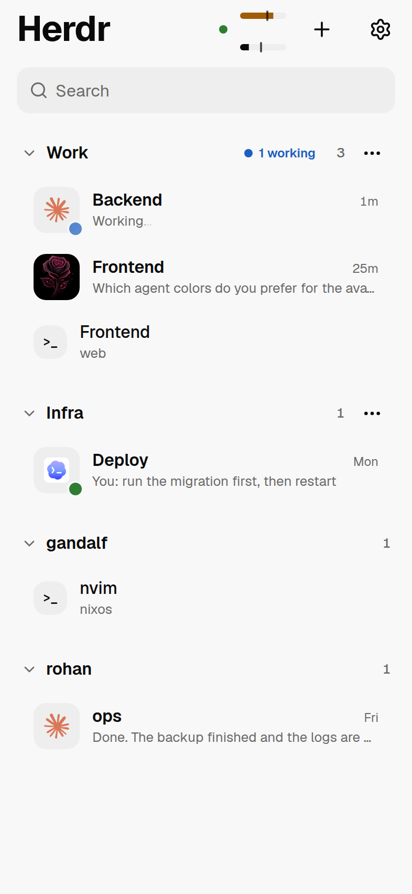</picture> <picture><source media="(prefers-color-scheme: dark)" srcset="docs/screenshots/chat-dark.png">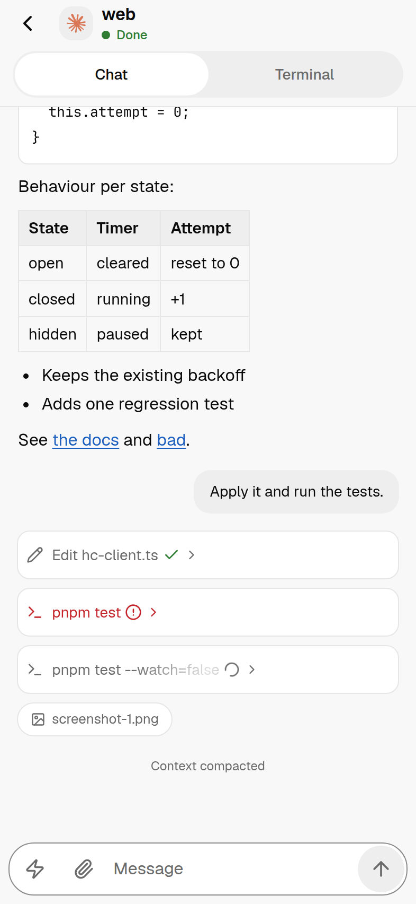</picture> <picture><source media="(prefers-color-scheme: dark)" srcset="docs/screenshots/permission-dark.png">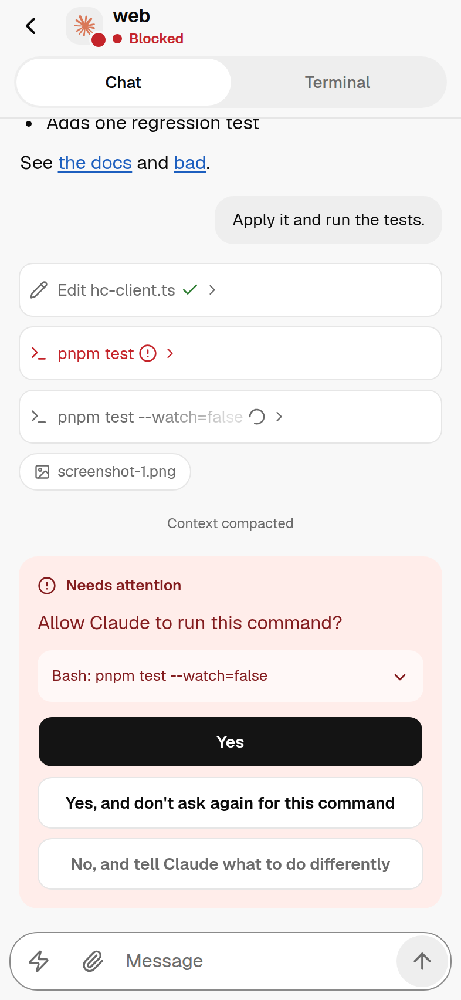</picture> <picture><source media="(prefers-color-scheme: dark)" srcset="docs/screenshots/terminal-dark.png">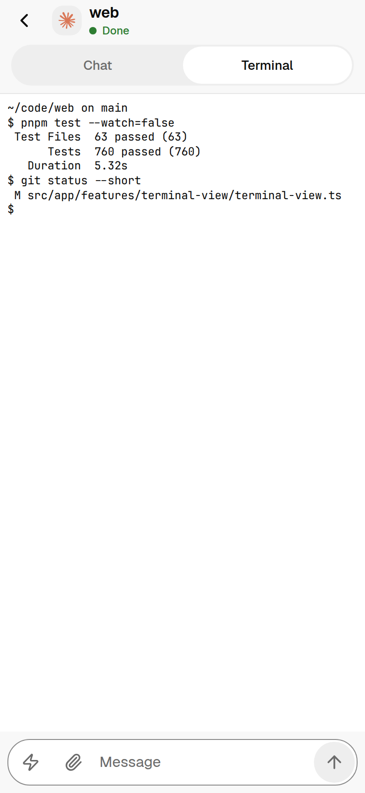</picture>
</p>

[](https://angular.dev)
[](https://www.typescriptlang.org)
[](https://tailwindcss.com)
[](https://spartan.ng)
[](https://xtermjs.org)
[](https://angular.dev/ecosystem/service-workers)
[](https://pnpm.io)

## What it is

An installable web app (PWA) built for the phone. It is a client for machines that already run
[herdr-core](https://github.com/herdrdev/herdr-core) (`hc`): agent terminals read as chats, the
real terminal is one tap away, and herdr projects, tabs and panes can be managed without the
desktop window. It does not replace the herdr desktop app and has no backend of its own.

It is served by [spacee-herdr-bridge](https://github.com/spacecodee/spacee-herdr-bridge), a small
Go service that embeds the production build and runs next to herdr-core. See the bridge's
[host setup guide](https://github.com/spacecodee/spacee-herdr-bridge/blob/main/docs/host-setup.md)
to deploy both.

```
phone (Safari / installed app) --https/wss--> spacee-herdr-bridge --Unix socket--> herdr-core
```

## Features

- **Home**: conversations grouped by herdr project in desktop order, with the last message of
  each agent, a Needs attention strip, and search.
- **Chat**: Claude Code, pi, Codex and opencode terminals open as a chat with markdown, code
  blocks, collapsible tool calls and live status. Answer questions and permission prompts with a tap.
- **Terminal**: xterm.js with WebGL, a Nerd Font for prompt icons, touch scrolling and a key bar
  (Esc, Tab, one-shot Ctrl, arrows).
- **Changes and files**: review the git changes of a terminal's folder, open a diff, or read a file.
- **Input**: message field with iOS autocorrect and dictation, saved prompts, drafts, image attach or paste.
- **Layout**: create projects, add tabs, split panes, rename, reorder and close from the phone.
- **Usage and Stats**: remaining agent quota per machine, and pull request statistics.
- **PWA**: installs to the home screen, works as a full-screen app, offers updates and receives
  push notifications when an agent needs you.
- **Resilience**: reconnects and re-attaches after the phone suspends the app.
- **Appearance**: follows the system light or dark theme; text size and scroll speed are adjustable.

## Screenshots

Light and dark follow your system theme. All data is fake, from the development fixtures.

| | | | |
| :---: | :---: | :---: | :---: |
| <picture><source media="(prefers-color-scheme: dark)" srcset="docs/screenshots/home-dark.png"></picture><br>Home | <picture><source media="(prefers-color-scheme: dark)" srcset="docs/screenshots/chat-dark.png"></picture><br>Chat | <picture><source media="(prefers-color-scheme: dark)" srcset="docs/screenshots/question-dark.png">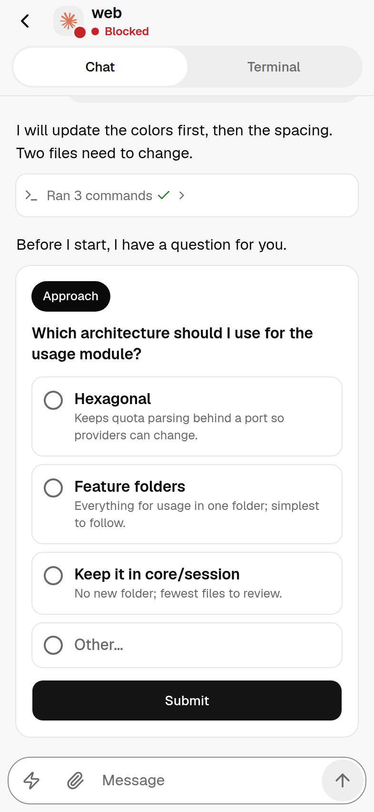</picture><br>Question | <picture><source media="(prefers-color-scheme: dark)" srcset="docs/screenshots/permission-dark.png"></picture><br>Permission |
| <picture><source media="(prefers-color-scheme: dark)" srcset="docs/screenshots/terminal-dark.png"></picture><br>Terminal | <picture><source media="(prefers-color-scheme: dark)" srcset="docs/screenshots/changes-dark.png">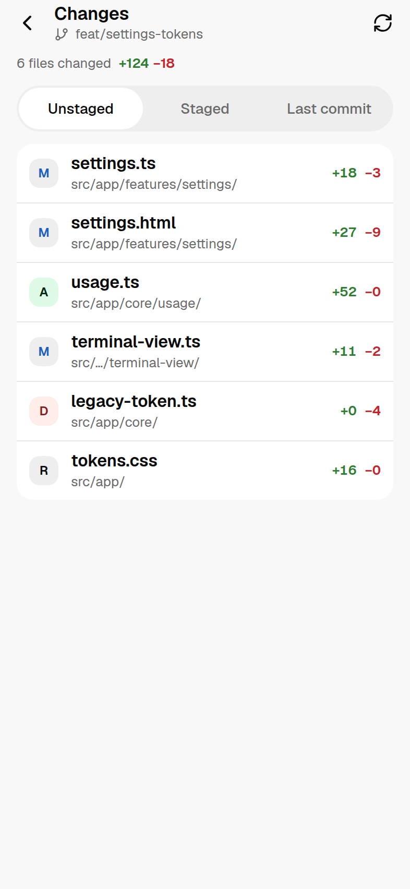</picture><br>Changes | <picture><source media="(prefers-color-scheme: dark)" srcset="docs/screenshots/diff-dark.png">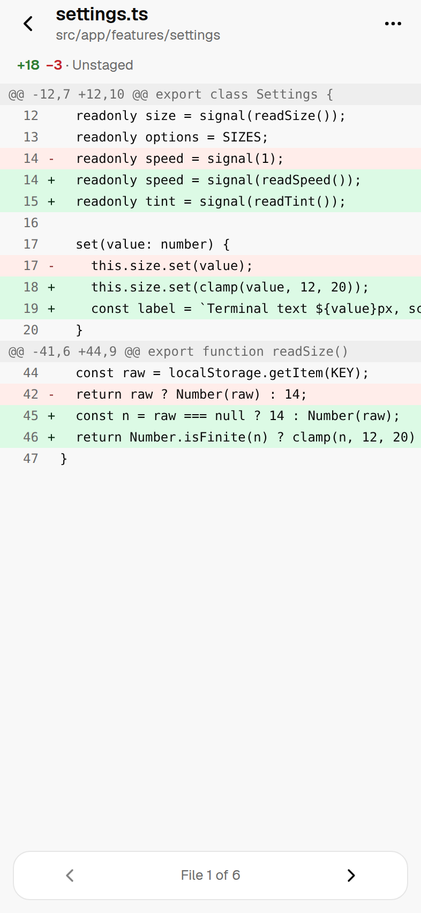</picture><br>Diff | <picture><source media="(prefers-color-scheme: dark)" srcset="docs/screenshots/file-dark.png">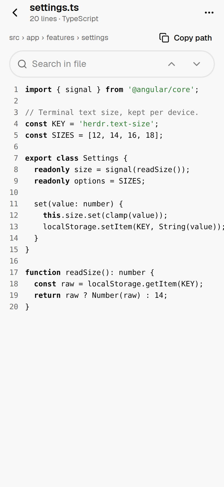</picture><br>File |
| <picture><source media="(prefers-color-scheme: dark)" srcset="docs/screenshots/usage-dark.png">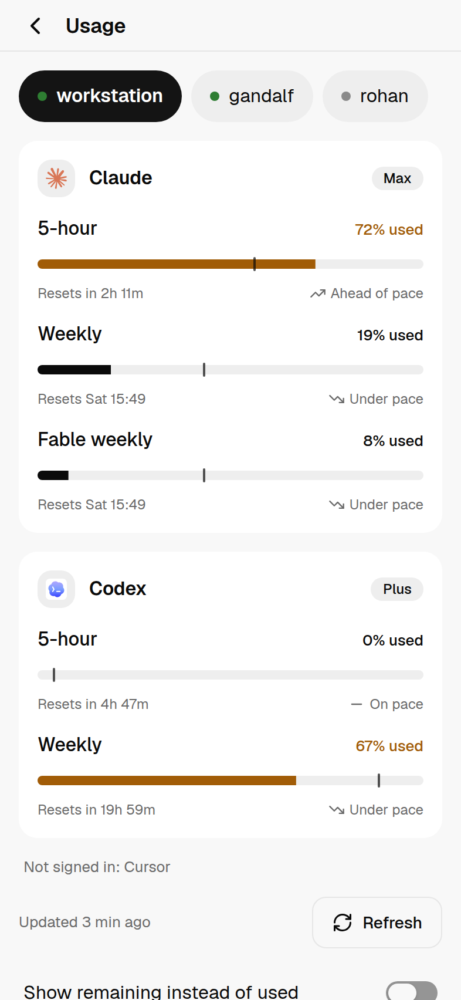</picture><br>Usage | <picture><source media="(prefers-color-scheme: dark)" srcset="docs/screenshots/stats-dark.png">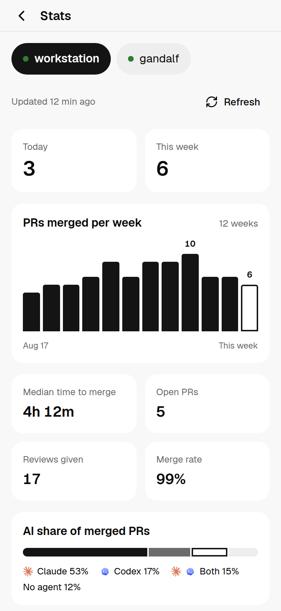</picture><br>Stats | <picture><source media="(prefers-color-scheme: dark)" srcset="docs/screenshots/settings-dark.png">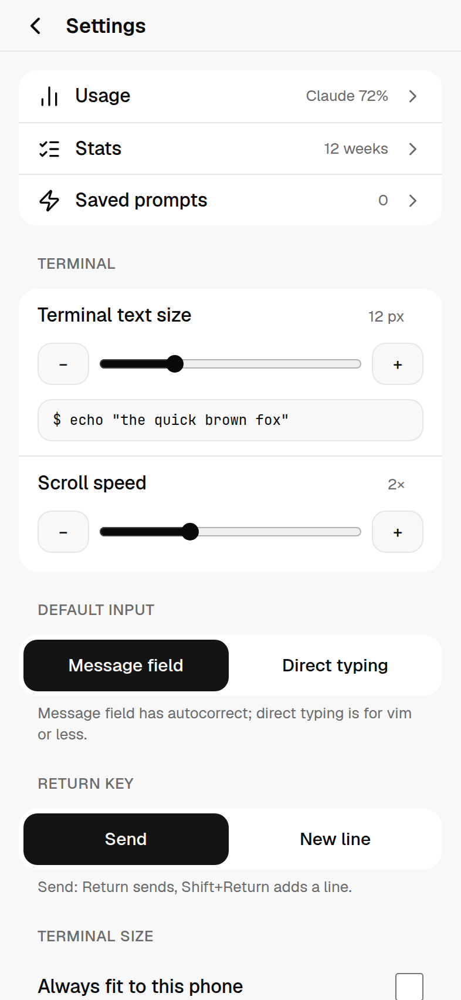</picture><br>Settings |  |

## Tech stack

- Angular 22 (standalone components, signals, zoneless change detection), no SSR
- Tailwind CSS 4 and [Spartan UI](https://spartan.ng) (message, bubble, message scroller,
  collapsible, sheet, popover, alert dialog)
- xterm.js 6 with the WebGL, fit and unicode11 addons
- Angular service worker
- marked and DOMPurify for sanitized markdown
- pnpm

## Development

### Getting started

Requirements: Node.js 22 or later (developed on 26), pnpm, and a running bridge for live data.

```sh
pnpm install
pnpm start
```

The dev server runs on `http://localhost:4200` and proxies `/api` and `/ws` to a bridge on
`http://127.0.0.1:8080` (see `proxy.conf.json`). Sign in with the bridge token from
`~/.config/spacee-herdr/token`.

### Scripts

| Command | Purpose |
| --- | --- |
| `pnpm start` | Development server with the bridge proxy. |
| `pnpm build` | Production build in `dist/spacee-herdr-frontend/browser`. |
| `pnpm test` | Unit tests. |

To deploy, copy the production build into the bridge and rebuild it:

```sh
pnpm build
cd ../spacee-herdr-bridge
rm -rf internal/webui/dist/* && cp -R ../spacee-herdr-frontend/dist/spacee-herdr-frontend/browser/. internal/webui/dist/
docker compose up -d --build
```

## How it talks to herdr-core

The bridge is a byte pipe for terminals: the app opens `/ws` and speaks the herdr-core framed
protocol itself (JSON-RPC 2.0 over frames with DATA, CREDIT, CLOSE, RESIZE, FOCUS and FACTS
channels), including flow control. The live terminal list comes from `events.subscribe`, and
the project layout from the core document `herdr-app`. Chat transcripts, summaries, push,
uploads and layout changes use the bridge's HTTP API.

## Project structure

```
src/app/
  core/
    hc/        framed protocol client, terminal store, spaces
    chat/      chat stream, summaries, markdown
    xterm/     terminal factory, key bytes, touch scroll and selection, themes
    input/     history, drafts, image preparation and upload
    layout/    layout API and actions
    list/      conversation rows, search and ordering
    pwa/       updates, push, diagnostics
    session/   sign-in and route guard
    settings/  persisted preferences
    theme/     system color scheme
  features/    login, terminal list, terminal view, chat view, layout menus, settings
libs/ui/       Spartan helm components
public/        icons, manifest, bundled fonts, agent icons
```

## Conventions

- Every Angular artifact is created with `pnpm ng generate`; templates and styles live in
  their own files.
- Spartan components are added with the Spartan CLI into `libs/ui`.
- Tests sit next to the code they cover.
- User-visible changes are recorded in [CHANGELOG.md](CHANGELOG.md).

## Credits

Agent icons: [LobeHub Icons](https://github.com/lobehub/lobe-icons) (MIT) and the Gentle AI
logo from gentle-pi (MIT); see `public/agents/README.md`. Terminal font: JetBrains Mono Nerd
Font (OFL); see `public/fonts/OFL.txt`.

## Third-party notices

The counting in Stats (`src/app/core/stats/`) is ported from the Herdr "stats" mod,
<https://github.com/Lakris2407/herdr-mods/tree/main/stats>, under the MIT License:

> Copyright (c) 2026 Lakris2407
>
> Permission is hereby granted, free of charge, to any person obtaining a copy of this software
> and associated documentation files (the "Software"), to deal in the Software without
> restriction, including without limitation the rights to use, copy, modify, merge, publish,
> distribute, sublicense, and/or sell copies of the Software, and to permit persons to whom the
> Software is furnished to do so, subject to the following conditions:
>
> The above copyright notice and this permission notice shall be included in all copies or
> substantial portions of the Software.
>
> THE SOFTWARE IS PROVIDED "AS IS", WITHOUT WARRANTY OF ANY KIND, EXPRESS OR IMPLIED, INCLUDING
> BUT NOT LIMITED TO THE WARRANTIES OF MERCHANTABILITY, FITNESS FOR A PARTICULAR PURPOSE AND
> NONINFRINGEMENT. IN NO EVENT SHALL THE AUTHORS OR COPYRIGHT HOLDERS BE LIABLE FOR ANY CLAIM,
> DAMAGES OR OTHER LIABILITY, WHETHER IN AN ACTION OF CONTRACT, TORT OR OTHERWISE, ARISING FROM,
> OUT OF OR IN CONNECTION WITH THE SOFTWARE OR THE USE OR OTHER DEALINGS IN THE SOFTWARE.

## License

[MIT](LICENSE) © 2026 spacecodee.
